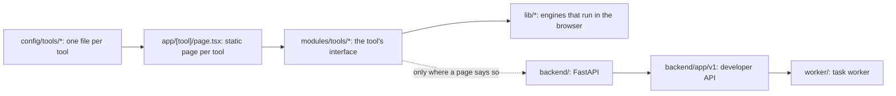

<p align="center">
  
</p>

<h1 align="center">GigAI Tools</h1>

<p align="center">
GigAI Tools is an open-source collection of 273 free file and developer tools that run in your browser: PDF, image, video, audio, QR, SVG, SEO and developer utilities. Most tools process your files on your own device, so nothing is uploaded. The few that need a server say so on the page and delete what they receive. It is the code behind <a href="https://gigai.tools">gigai.tools</a>.
</p>

<p align="center">
  <a href="https://gigai.tools"></a>
  <a href="https://github.com/cbsshekhawat18-lab/gigai-tools/actions/workflows/ci.yml"></a>
  <a href="https://cbsshekhawat18-lab.github.io/gigai-tools/"></a>
  <a href="LICENSE"></a>
  
  
</p>

<p align="center">
  <b><a href="https://gigai.tools">Live site</a></b> &nbsp;·&nbsp;
  <b><a href="#quickstart">Quickstart</a></b> &nbsp;·&nbsp;
  <b><a href="https://cbsshekhawat18-lab.github.io/gigai-tools/">Docs</a></b>
</p>

## Why GigAI Tools exists

Most free online tools ask you to upload the file first. A contract you want to compress, a photo you want to resize or a recording you want to trim goes to someone else's server, and you trust them to delete it. Browsers can now do this work themselves: WebAssembly runs FFmpeg and PDF engines, and on-device models can transcribe speech. GigAI Tools puts that work in the browser tab, behind one consistent interface, and is open source so you can check what each tool does with your file.

## What is GigAI Tools

**The problem.** File tools are scattered across many sites, most of them upload your files, and you cannot see what happens to a file after it leaves your device.

**How GigAI Tools solves it.** Each tool is a page whose engine runs in your browser: pdf.js and pdf-lib for PDFs, ffmpeg.wasm for video and audio, Transformers.js for speech-to-text, tesseract.js for OCR, svgo for SVG. You can read every engine in [`lib/`](lib/).

**What you get.** 273 tools in 13 categories, 9 workspaces that chain tools on one file, guides that explain the formats, and an optional backend for the few jobs a browser cannot do.

**What it does not do.** It does not keep your files, and it has no accounts for the tools themselves. The optional developer API, which does process files on a server, is a separate part with its own accounts.

## Demo

The live site runs this repository: <https://gigai.tools>. Some starting points:

- [Compress PDF](https://gigai.tools/compress-pdf), [Merge PDF](https://gigai.tools/merge-pdf), [Redaction Checker](https://gigai.tools/redaction-checker)
- [Image Compressor](https://gigai.tools/image-compressor), [HEIC to JPG](https://gigai.tools/heic-to-jpg)
- [Video Frame Extractor](https://gigai.tools/video-frame-extractor), [Audio Volume Booster](https://gigai.tools/audio-volume-booster)
- [Secret Scanner](https://gigai.tools/secret-scanner), [Social Share Inspector](https://gigai.tools/social-share-inspector)

## What you get

| Category | Live tools | Examples |
|---|---|---|
| SEO | 51 | robots.txt and sitemap validators, meta and schema checkers |
| PDF | 38 | compress, merge, split, OCR, edit text, redaction checker |
| QR | 36 | Wi-Fi, vCard, event, payment and artistic QR codes |
| Developer | 32 | JSON and YAML formatters, regex generator, JWT decoder, secret scanner |
| SVG | 30 | optimizer, converters, gradient and animation generators |
| Video | 28 | converter, trimmer, frame extractor, Video to Work |
| Audio | 25 | converter, merger, ringtone maker, volume booster |
| GEO | 11 | checks for how AI answer engines read a page |
| Image | 10 | compressor, resizer, cropper, format converters |
| Document | 9 | text, Markdown and HTML to PDF, Word to PDF |
| File intelligence | 3 | identify a file, check it fits an upload limit |

The counts come from the tool registry in [`config/tools/`](config/tools/). The categories AI and Business have tools marked "coming soon" and none live yet.

## Who is it for?

- **People** who want to convert, compress or check a file without uploading it.
- **Developers** who want working examples of PDF, media and ML engines running in the browser, or a base for their own tools site.
- **Teams** who want to self-host a set of file tools on their own domain.

## Quickstart

You need Node 20 or later. This runs the website on your machine:

```sh
git clone https://github.com/cbsshekhawat18-lab/gigai-tools.git
cd gigai-tools
npm install          # also copies the ffmpeg.wasm core into public/ffmpeg/
npm run dev          # http://localhost:3000
```

Every tool that runs in the browser works with nothing else installed. To build the static site, run `npm run build`; the result is in `out/` and any static file host can serve it.

The backend is optional. It serves Video to Work analysis, GigAI Verify, PDF repair and the developer API. It needs Python 3.12 or later:

```sh
cd backend
python3 -m venv .venv && . .venv/bin/activate
pip install -r requirements.txt
uvicorn app.main:app --reload   # http://localhost:8000/docs
```

Copy [`.env.example`](.env.example) to `.env` and `backend/.env` to turn on the features that need settings. [Configuration](docs/configuration.md) lists every setting.

## How it works



A tool is a file in [`config/tools/`](config/tools/) that holds its name, copy, FAQ and related tools. The site turns each entry into a static page with its own metadata and structured data. The page loads the tool's interface from [`modules/tools/`](modules/tools/), which calls an engine in [`lib/`](lib/). [Architecture](docs/architecture.md) explains each layer, and [Adding a tool](docs/adding-a-tool.md) walks through a new one.

## Documentation

The documentation site is <https://cbsshekhawat18-lab.github.io/gigai-tools/>. The same pages are in [`docs/`](docs/):

- [Quickstart](docs/quickstart.md): run the site and the backend locally.
- [All tools](docs/tools/index.md): every tool by category, with what it does and where it runs.
- [What runs where](docs/privacy-model.md): which tools use a server, and what it keeps.
- Run each part: [the website](docs/guides/website.md), [the backend](docs/guides/backend.md), [the developer API](docs/guides/developer-api.md), [the task worker](docs/guides/worker.md), [the fetch proxies](docs/guides/fetch-proxies.md), [PDF repair](docs/guides/pdf-repair.md) and the [API clients](docs/guides/clients.md).
- [Self-hosting](docs/self-hosting.md) and [Configuration](docs/configuration.md): your own server, Docker, and every setting.
- [Architecture](docs/architecture.md) and [Adding a tool](docs/adding-a-tool.md): how it is built, and how to extend it.
- [Video to Work](docs/video-to-work.md) and [Video Intelligence](docs/video-intelligence.md): how the two video analysis tools work.
- [FAQ](docs/faq.md).

## FAQ

**Is every tool private?** 241 of the 273 run only in your browser: the file never leaves it. 29 SEO and GEO tools can read a live URL through a fetch proxy, and pasted input stays local. 3 tools use the backend for one part: Video to Work's analysis, IconLab's AI composer and PDF to Excel's optional OCR repair. Each says so on its page. [What runs where](docs/privacy-model.md) lists them.

**Can I run it without the backend?** Yes. The browser tools need only the static site. Video to Work analysis, GigAI Verify, IconLab's AI composer, PDF repair and the developer API need the backend, and say so when it is missing.

**Is the developer API production-ready?** It runs gigai.tools' API today, on one server with PostgreSQL. It has no horizontal scaling, and its object storage is local disk.

**Can I use the code in my own product?** Yes, under the Apache License 2.0. The GigAI name and logo are not part of that licence: a public fork must use its own name and logo. See [TRADEMARKS.md](TRADEMARKS.md).

**Why is one folder under a different licence?** [`backend/app/pdf_repair/`](backend/app/pdf_repair/) uses PyMuPDF, which is AGPL-3.0, so that folder is AGPL-3.0 too. It is off by default; the rest of the repository is Apache-2.0.

More answers are in the [FAQ](docs/faq.md).

## Contributing

Read [CONTRIBUTING.md](CONTRIBUTING.md) and the [Code of Conduct](CODE_OF_CONDUCT.md). Bug reports with a sample file that fails help most. Report security problems privately, as [SECURITY.md](SECURITY.md) describes.

## Related repositories

- [gigai-tools-node](https://github.com/cbsshekhawat18-lab/gigai-tools-node): Node client and CLI for the developer API.
- [gigai-tools-python](https://github.com/cbsshekhawat18-lab/gigai-tools-python): Python client for the developer API.
- [gigai-tools-mcp](https://github.com/cbsshekhawat18-lab/gigai-tools-mcp): MCP server that gives AI agents the API's file tools.

## License

[Apache License 2.0](LICENSE), except [`backend/app/pdf_repair/`](backend/app/pdf_repair/LICENSE), which is AGPL-3.0-or-later. Third-party components are listed in [THIRD_PARTY_NOTICES.md](THIRD_PARTY_NOTICES.md). The GigAI name and logo are trademarks; see [TRADEMARKS.md](TRADEMARKS.md). Built and maintained by Chandrabhan Shekhawat, Gigai Kripa Services (<https://gigaikripaservices.com/>).
