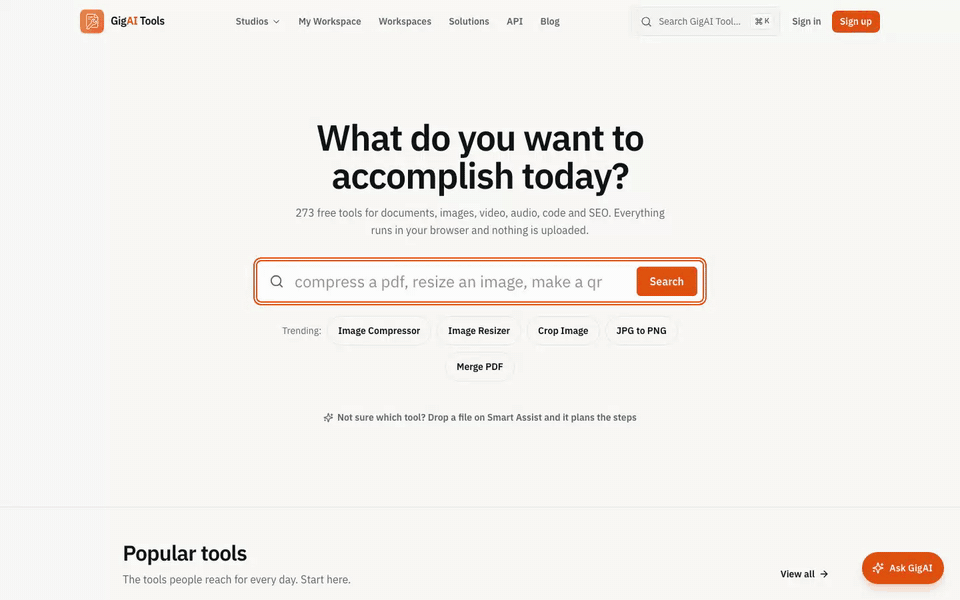
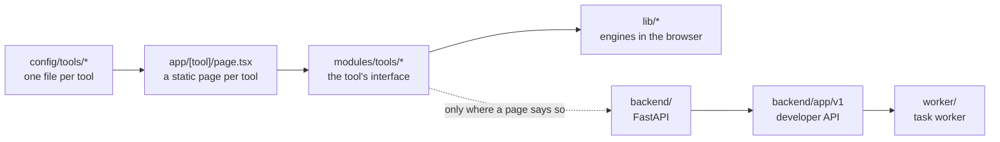

<p align="center">
  <picture>
    <source media="(prefers-color-scheme: dark)" srcset="https://raw.githubusercontent.com/cbsshekhawat18-lab/gigai-tools/main/public/brand/gigai-tools-horizontal-dark.png">
    
  </picture>
</p>

<h3 align="center">273 free file and developer tools that run in your browser</h3>

<p align="center">
GigAI Tools is an open-source collection of free online tools for PDF, image, video, audio, QR, SVG, SEO and developer work. Most tools process your file on your own device, so nothing is uploaded. The few that need a server say so on the page and delete what they receive. It is the code behind <a href="https://gigai.tools">gigai.tools</a>, and you can run it on your own machine or domain.
</p>

<p align="center">
  <a href="https://gigai.tools"></a>
  <a href="https://github.com/cbsshekhawat18-lab/gigai-tools/actions/workflows/ci.yml"></a>
  <a href="https://cbsshekhawat18-lab.github.io/gigai-tools/"></a>
  <a href="LICENSE"></a>
  <a href="https://github.com/cbsshekhawat18-lab/gigai-tools/stargazers"></a>
  <a href="https://github.com/cbsshekhawat18-lab/gigai-tools/commits/main"></a>
  <a href="CONTRIBUTING.md"></a>
  
  
</p>

<p align="center">
  <b><a href="https://gigai.tools">Live site</a></b> &nbsp;·&nbsp;
  <b><a href="#quickstart">Quickstart</a></b> &nbsp;·&nbsp;
  <b><a href="https://cbsshekhawat18-lab.github.io/gigai-tools/">Docs</a></b> &nbsp;·&nbsp;
  <b><a href="docs/tools/index.md">All 273 tools</a></b>
</p>

> **Status:** in production. This repository is the code that runs [gigai.tools](https://gigai.tools). On every push, CI typechecks and lints the website, runs the website, backend and worker tests, builds the whole static site and scans for secrets. The developer API is the youngest part: it runs on one server with PostgreSQL and keeps its files on local disk.

---

## Demo

<p align="center">
  
</p>

Search, open a tool, drop a file, download the result. The whole run above happens in the browser tab. Try it on the live site, or run it on your machine:

```sh
git clone https://github.com/cbsshekhawat18-lab/gigai-tools.git
cd gigai-tools
npm install && npm run dev   # http://localhost:3000
```

> ⭐ **If GigAI Tools is useful to you, please star the repo.** It helps other people looking for free, private file tools find the project.

---

## Why GigAI Tools exists

Most free online tools ask you to upload the file first. A contract you want to compress, a photo you want to resize or a recording you want to trim goes to someone else's server, and you trust them to delete it.

Browsers can now do this work themselves. WebAssembly runs FFmpeg and PDF engines, and on-device models can transcribe speech. GigAI Tools puts that work in the browser tab, behind one consistent interface, and is open source so you can check what each tool does with your file.

## What is GigAI Tools

**The problem.** File tools are scattered across many sites, most of them upload your files, and you cannot see what happens to a file after it leaves your device.

**How GigAI Tools solves it.** Each tool is a page whose engine runs in your browser: pdf.js and pdf-lib for PDFs, ffmpeg.wasm for video and audio, Transformers.js for speech-to-text, tesseract.js for OCR, svgo for SVG. You can read every engine in [`lib/`](lib/).

**What you get.** 273 live tools in 11 categories, 9 workspaces that chain tools on one file, guides that explain the formats, and an optional backend for the few jobs a browser cannot do.

**What it does not do.** It does not keep your files, and the tools need no account. The optional developer API, which does process files on a server, is a separate part with its own accounts.

---

## Documentation

Full guides live on the **[docs site](https://cbsshekhawat18-lab.github.io/gigai-tools/)**, built from [`docs/`](docs/):

- [Quickstart](docs/quickstart.md): run the website and the backend on your machine
- [All tools](docs/tools/index.md): every tool by category, with what it does and where it runs
- [What runs where](docs/privacy-model.md): which tools use a server, and what the server keeps
- [Run each part](docs/guides/website.md): [the website](docs/guides/website.md), [the backend](docs/guides/backend.md), [the developer API](docs/guides/developer-api.md), [the task worker](docs/guides/worker.md), [the fetch proxies](docs/guides/fetch-proxies.md), [PDF repair](docs/guides/pdf-repair.md) and the [API clients](docs/guides/clients.md)
- [Self-hosting](docs/self-hosting.md): your own server, with Docker or without
- [Configuration](docs/configuration.md): every setting, and what turns each feature on
- [Architecture](docs/architecture.md): the registry, the pages, the interfaces and the engines
- [Adding a tool](docs/adding-a-tool.md): a new tool from config to tests
- [Video to Work](docs/video-to-work.md) and [Video Intelligence](docs/video-intelligence.md): how the two video analysis tools work
- [FAQ](docs/faq.md): common questions and fixes

---

## Features

273 live tools in 11 categories, each one a page with its own guide, FAQ and related tools. Every category below links to its full list.

<table>
<tr>
<td width="50%" valign="top">

**📄 [PDF Studio](docs/tools/pdf-tools.md): 38 tools**

- [Compress](https://gigai.tools/compress-pdf), [merge](https://gigai.tools/merge-pdf), [split](https://gigai.tools/split-pdf) and [reorder pages](https://gigai.tools/reorder-pdf-pages)
- [Edit the existing text](https://gigai.tools/pdf-editor), [fill forms](https://gigai.tools/pdf-forms) and [sign](https://gigai.tools/document-signature)
- [OCR](https://gigai.tools/ocr-pdf) and [PDF to Excel](https://gigai.tools/pdf-to-excel), one row per record
- [Redact](https://gigai.tools/redact-pdf), then check it with the [Redaction Checker](https://gigai.tools/redaction-checker)
- [Protect](https://gigai.tools/pdf-password-protect) and [unlock](https://gigai.tools/unlock-pdf)

</td>
<td width="50%" valign="top">

**🖼️ [Image Studio](docs/tools/image-tools.md): 10 tools**

- [Image Compressor](https://gigai.tools/image-compressor), down to an exact size
- [HEIC to JPG](https://gigai.tools/heic-to-jpg), [WebP](https://gigai.tools/webp-converter), [PNG and JPG](https://gigai.tools/png-to-jpg) converters
- [Resize](https://gigai.tools/image-resizer) and [crop](https://gigai.tools/crop-image)
- [Remove Metadata](https://gigai.tools/remove-metadata): strip location and camera data
- [AI Image Upscaler](https://gigai.tools/image-upscaler), on your device

</td>
</tr>
<tr>
<td valign="top">

**🎬 [Video Studio](docs/tools/video-tools.md): 28 tools**

- [Convert](https://gigai.tools/video-converter), [compress](https://gigai.tools/video-compressor), [trim](https://gigai.tools/video-trimmer) and [merge](https://gigai.tools/video-merger)
- [Frames](https://gigai.tools/video-frame-extractor), [GIFs](https://gigai.tools/video-to-gif) and [thumbnails](https://gigai.tools/video-thumbnail-generator)
- [Subtitle Converter](https://gigai.tools/subtitle-converter)
- [Video Intelligence](https://gigai.tools/video-intelligence): Whisper transcripts in the browser
- [Video to Work](https://gigai.tools/video-to-work): a recording turned into tickets

</td>
<td valign="top">

**🎧 [Audio Studio](docs/tools/audio-tools.md): 25 tools**

- [Cut](https://gigai.tools/audio-cutter), [join](https://gigai.tools/audio-joiner), [fade](https://gigai.tools/audio-fade) and [reverse](https://gigai.tools/audio-reverse)
- [Normalize](https://gigai.tools/audio-normalizer), [boost the volume](https://gigai.tools/audio-volume-booster) and [remove silence](https://gigai.tools/audio-silence-remover)
- [Change the speed](https://gigai.tools/audio-speed-changer) and keep the pitch
- [MP3](https://gigai.tools/mp3-converter), [WAV](https://gigai.tools/wav-converter), [FLAC](https://gigai.tools/flac-converter) and other converters
- [Recorder](https://gigai.tools/audio-recorder) and [Ringtone Maker](https://gigai.tools/ringtone-maker)

</td>
</tr>
<tr>
<td valign="top">

**🧑‍💻 [Developer Studio](docs/tools/developer-tools.md): 32 tools**

- [JSON](https://gigai.tools/json-formatter), [YAML](https://gigai.tools/yaml-formatter), [SQL](https://gigai.tools/sql-formatter) and [XML](https://gigai.tools/xml-formatter) formatters
- [Secret Scanner](https://gigai.tools/secret-scanner): API keys in pasted code
- [Regex Generator](https://gigai.tools/regex-generator) and [Regex Tester](https://gigai.tools/regex-tester)
- [JWT Decoder](https://gigai.tools/jwt-decoder) and [LLM Token Counter](https://gigai.tools/token-counter)
- [UUID](https://gigai.tools/uuid-generator), [hash](https://gigai.tools/hash-generator) and [password](https://gigai.tools/password-generator) generators

</td>
<td valign="top">

**🔍 [SEO Studio](docs/tools/seo-tools.md): 51 tools**

- [Social Share Inspector](https://gigai.tools/social-share-inspector): previews on 8 platforms
- [Robots.txt](https://gigai.tools/robots-txt-validator) and [sitemap](https://gigai.tools/sitemap-validator) validators
- [Schema generators](https://gigai.tools/schema-generator) and the [Schema Validator](https://gigai.tools/schema-validator)
- [Meta Tag Analyzer](https://gigai.tools/meta-tag-analyzer) and [SERP preview](https://gigai.tools/google-serp-preview)
- [Security headers](https://gigai.tools/security-header-checker) and [SSL](https://gigai.tools/ssl-checker) checks

</td>
</tr>
<tr>
<td valign="top">

**🔳 [QR Studio](docs/tools/qr-tools.md): 36 tools**

- [QR Code Generator](https://gigai.tools/qr-code-generator) and [QR with a logo](https://gigai.tools/qr-code-with-logo)
- [Wi-Fi](https://gigai.tools/wifi-qr-code-generator), [vCard](https://gigai.tools/vcard-qr-code-generator), [event](https://gigai.tools/event-qr-code-generator) and [payment](https://gigai.tools/payment-qr-code-generator) codes
- [Bulk QR Code Generator](https://gigai.tools/bulk-qr-code-generator) from a spreadsheet
- [Decode](https://gigai.tools/qr-code-decoder) or [scan](https://gigai.tools/qr-code-scanner) a code

**✒️ [SVG Studio](docs/tools/svg-tools.md): 30 tools**

- [SVG Optimizer](https://gigai.tools/svg-optimizer) on svgo, with a plugin panel and size stats
- [SVG to React](https://gigai.tools/svg-to-react), [Vue](https://gigai.tools/svg-to-vue), [PNG](https://gigai.tools/svg-to-png) and [data URI](https://gigai.tools/svg-to-data-uri)
- [Trace a PNG to SVG](https://gigai.tools/png-to-svg)
- [Blob](https://gigai.tools/svg-blob-generator), [wave](https://gigai.tools/svg-wave-generator) and [gradient](https://gigai.tools/svg-gradient-generator) generators

</td>
<td valign="top">

**🤖 [GEO Studio](docs/tools/geo-tools.md): 11 tools**

- [AI Crawler Access Checker](https://gigai.tools/ai-crawler-access-checker): can AI crawlers reach a page
- [JS Rendering Checker](https://gigai.tools/js-rendering-checker): can they read it without JavaScript
- [Content Citability Scorer](https://gigai.tools/content-citability-scorer) and [Retrieval Chunk Preview](https://gigai.tools/retrieval-chunk-preview)
- [llms.txt Generator](https://gigai.tools/llms-txt-generator) and [AI robots.txt](https://gigai.tools/ai-robots-txt-generator)

**📑 [Document Studio](docs/tools/document-tools.md): 9 tools**

- [CSV Editor](https://gigai.tools/csv-editor), [CSV to Excel](https://gigai.tools/csv-to-excel) and [JSON to CSV](https://gigai.tools/json-to-csv)
- [EPUB](https://gigai.tools/epub-viewer) and [RTF](https://gigai.tools/rtf-viewer) viewers

**🧠 [File Intelligence](docs/tools/file-intelligence.md): 3 tools**

- [GigAI Fit](https://gigai.tools/gigai-fit): hit an upload limit exactly
- [GigAI Verify](https://gigai.tools/gigai-verify) and [GigAI IconLab](https://gigai.tools/icon-lab)

</td>
</tr>
</table>

<details>
<summary><strong>Also included</strong>: the rest of the site around the tools</summary>

- **Workspaces**: 9 of them ([PDF](https://gigai.tools/pdf-workspace), [image](https://gigai.tools/image-workspace), [video](https://gigai.tools/video-workspace), [audio](https://gigai.tools/audio-workspace), [document](https://gigai.tools/document-workspace), [QR](https://gigai.tools/qr-workspace), [SVG](https://gigai.tools/svg-workspace), [SEO](https://gigai.tools/seo-workspace) and [developer](https://gigai.tools/developer-workspace)) that chain tools on one file
- **Smart Assist** ([`/assist`](https://gigai.tools/assist)): drop a file, say what you want, and it plans the steps with the existing tools
- **Problem pages** ([`/solve`](https://gigai.tools/solve)): pages phrased as the problem, such as a file that is over an upload limit, each pointing to the tools that fix it
- **Glossary** ([`/glossary`](https://gigai.tools/glossary)) and **how-to guides** for the file formats and terms the tools use
- **Search** across tools, guides and problem pages
- **Offline support**: a service worker keeps browser tools working after the first visit
- **Developer API** ([`/developers`](https://gigai.tools/developers)): accounts, API keys, jobs, webhooks and site audits, with a [Node client](https://github.com/cbsshekhawat18-lab/gigai-tools-node), a [Python client](https://github.com/cbsshekhawat18-lab/gigai-tools-python) and an [MCP server](https://github.com/cbsshekhawat18-lab/gigai-tools-mcp)
- **Structured data** on every page: tool, FAQ, how-to and breadcrumb schema, a sitemap and an `llms.txt`

</details>

### Where each tool runs

| Runs | Tools | What happens to your data |
|---|---|---|
| Browser | 241 | Processed on your device. Nothing is uploaded. |
| Browser, URL via proxy | 29 | Pasted content stays on your device. A URL you enter is fetched by the site's proxy. |
| Browser and backend | 3 | One part uses the backend: Video to Work's analysis, IconLab's AI composer, PDF to Excel's optional OCR repair. The page says so first. |

[What runs where](docs/privacy-model.md) lists every tool and what the server keeps.

---

## Who is it for?

- **People** who want to convert, compress or check a file without uploading it.
- **Developers** who want working examples of PDF, media and on-device ML engines in the browser, or a base for their own tools site.
- **Teams and schools** who want a set of file tools on their own domain, with no files leaving their network.
- **Privacy reviewers** who want to read exactly what a tool does with a file before they recommend it.

## How it works

1. **A tool is one file in [`config/tools/`](config/tools/)**: its name, copy, steps, FAQ and related tools.
2. **The site makes a static page for it** at `app/[tool]/page.tsx`, with its own metadata and structured data.
3. **The page loads the tool's interface** from [`modules/tools/`](modules/tools/), registered in `components/tool/tool-ui-registry.ts`.
4. **The interface calls an engine** in [`lib/`](lib/): plain TypeScript with no React, tested with Vitest.
5. **Only where a page says so**, the interface calls the optional [`backend/`](backend/).



A tool's entry is plain data. Here is one, shortened:

```ts
const uuidGenerator: Tool = {
  slug: "uuid-generator",
  title: "UUID Generator",
  description: "Generate secure UUIDs instantly, random v4, time-ordered v7, or the nil UUID. ...",
  category: "developer-tools",
  icon: "Fingerprint",
  status: "live",
  // h1, tagline, features, howTo, formats, faq, relatedTools ...
};
```

From that entry the site builds the page at `/uuid-generator`, its title and description, its FAQ and how-to schema, its place in the category, search and sitemap, and the links from related tools. [Architecture](docs/architecture.md) explains each layer, and [Adding a tool](docs/adding-a-tool.md) walks through a new one.

## How it compares

An honest, structural comparison with the usual upload-first online tool sites.

| | **GigAI Tools** | Upload-first tool sites |
|---|---|---|
| Where your file is processed | **In your browser**, for 241 of 273 tools | On their server |
| Source code | **Public (Apache-2.0)** | Closed |
| Account | **None for the tools** | Often needed for bigger files |
| Self-hosting | **Yes, as a static site** | No |
| Offline | **Browser tools, after the first visit** | No |
| File size limit | Your device's memory | Their upload cap |
| Speed on large files | Depends on your device | Depends on their servers |
| Support | Community, one maintainer | Usually commercial |

---

## Tech stack

| Layer | What |
|---|---|
| Website | Next.js 15 (static export), React 19, TypeScript 5 |
| Styling | Tailwind CSS 4, IBM Plex, lucide icons |
| PDF engines | pdf.js 5, pdf-lib |
| Media engines | ffmpeg.wasm 0.12, the Web Audio API |
| On-device ML | Transformers.js 4 (Whisper speech-to-text), tesseract.js 7 (OCR) |
| SVG | svgo 4 |
| Tests | Vitest 4 (website), pytest (backend), `node --test` (worker) |
| Backend | FastAPI, Pydantic 2, Python 3.12+ |
| Developer API | FastAPI on PostgreSQL (psycopg), Argon2 passwords, JWT sessions |
| Task worker | Node 22, PostgreSQL job queue (`FOR UPDATE SKIP LOCKED`) |
| Fetch proxy | A Cloudflare Worker for social previews ([`cloudflare/social-fetch`](cloudflare/social-fetch/)) |
| Docs | MkDocs Material on GitHub Pages |

---

## Self-hosting / installation

### Quickstart

You need Node 20 or later. This runs the website on your machine:

```sh
git clone https://github.com/cbsshekhawat18-lab/gigai-tools.git
cd gigai-tools
npm install          # also copies the ffmpeg.wasm core into public/ffmpeg/
npm run dev          # http://localhost:3000
```

Every tool that runs in the browser works with nothing else installed.

### Option A: Docker

The website and the backend in two containers:

```sh
cp .env.example backend/.env   # then fill in what you use
docker compose up --build
# website: http://localhost:8080
# backend: http://localhost:8000/docs
```

The developer API (`/v1`) also needs PostgreSQL; [Self-hosting](docs/self-hosting.md) shows how.

### Option B: manual

**Website.** Build the static site and serve `out/` from any static file host:

```sh
npm run build        # the static site is in out/
```

**Backend** (optional). It serves Video to Work analysis, GigAI Verify, IconLab's AI composer, PDF repair and the developer API. It needs Python 3.12 or later:

```sh
cd backend
python3 -m venv .venv && . .venv/bin/activate
pip install -r requirements.txt
uvicorn app.main:app --reload   # http://localhost:8000/docs
```

**Task worker** (only with the developer API). It needs Node 22 and the API's PostgreSQL database; see [the task worker guide](docs/guides/worker.md).

Copy [`.env.example`](.env.example) to `.env` and `backend/.env` to turn on the features that need settings. A fresh clone loads no ads and no analytics. [Configuration](docs/configuration.md) lists every setting.

### Production

[`ops/`](ops/) has example nginx, systemd and cron files for one Linux server, with placeholder names and paths. [Self-hosting](docs/self-hosting.md) walks through them.

---

## Project layout

```
gigai-tools/
├── app/                   Next.js routes: [tool]/ makes every tool page
├── components/            Shared UI: layout, tool workspace, uploaders, export
├── config/
│   ├── tools/             One file per tool, grouped by category
│   ├── categories.ts      The 11 studios
│   └── workspaces.ts      The 9 workspaces
├── modules/tools/         Each tool's interface, one component per tool
├── lib/                   Engines (pdf/, image/, audio-tools/, qr/, svg-tools/, ...)
├── content/blog/          Guides and articles
├── public/                Static files, the service worker, brand files
├── backend/               FastAPI service
│   ├── app/api/           Video to Work, Verify, IconLab, newsletter, convert
│   ├── app/v1/            Developer API: accounts, keys, jobs, webhooks, posters
│   └── app/pdf_repair/    Optional PDF repair (AGPL-3.0)
├── worker/                Task worker for the developer API
├── cloudflare/            Fetch proxy for social previews
├── scripts/               Docs generator, ffmpeg copy, QA scripts
├── ops/                   Example nginx, systemd and cron files
└── docs/                  The documentation site
```

---

## FAQ

**Is every tool private?**
241 of the 273 run only in your browser: the file never leaves it. 29 SEO and GEO tools can read a live URL through a fetch proxy, and pasted input stays local. 3 tools use the backend for one part, and each says so on its page. [What runs where](docs/privacy-model.md) lists them.

**Can I run it without the backend?**
Yes. The browser tools need only the static site. Video to Work analysis, GigAI Verify, IconLab's AI composer, PDF repair and the developer API need the backend, and say so when it is missing.

**Is the developer API production-ready?**
It runs the gigai.tools API today, on one server with PostgreSQL. It has no horizontal scaling, and its object storage is local disk.

**Can I use the code in my own product?**
Yes, under the Apache License 2.0. The GigAI name and logo are not part of that license: a public fork must use its own name and logo. See [TRADEMARKS.md](TRADEMARKS.md).

**Why is one folder under a different license?**
[`backend/app/pdf_repair/`](backend/app/pdf_repair/) uses PyMuPDF, which is AGPL-3.0, so that folder is AGPL-3.0 too. It is off by default; the rest of the repository is Apache-2.0.

**How do I add a tool?**
Add its entry in `config/tools/`, its interface in `modules/tools/` and its engine in `lib/`, then run the checks. [Adding a tool](docs/adding-a-tool.md) has each step.

More answers are in the [FAQ](docs/faq.md).

---

## Contributing

GigAI Tools is an open codebase and pull requests are welcome. Read [CONTRIBUTING.md](CONTRIBUTING.md) and the [Code of Conduct](CODE_OF_CONDUCT.md). Good places to start:

- A file that gives a wrong result: [open an issue](https://github.com/cbsshekhawat18-lab/gigai-tools/issues/new/choose) with the file, if you can share it
- A tool you are missing: use the tool request form
- Tests for an engine in `lib/` that has few
- Accessibility fixes in the tool interfaces

Run the checks before a pull request:

```sh
npm run typecheck && npm run lint && npm test
npm run docs:tools   # keeps docs/tools/ in step with config/tools/
```

⭐ **Starring the repo is the easiest way to help.** It shows the project to more people who need file tools that do not upload their files.

### Related repositories

- [gigai-tools-node](https://github.com/cbsshekhawat18-lab/gigai-tools-node): Node client and CLI for the developer API
- [gigai-tools-python](https://github.com/cbsshekhawat18-lab/gigai-tools-python): Python client for the developer API
- [gigai-tools-mcp](https://github.com/cbsshekhawat18-lab/gigai-tools-mcp): MCP server that gives AI agents the API's file tools

---

## Author & Credits

**GigAI Tools** is built and maintained by **Chandrabhan Shekhawat**, **Gigai Kripa Services**.

- 🧰 Live site: <https://gigai.tools>
- 🌐 Website: <https://gigaikripaservices.com/>
- 👤 Author: Chandrabhan Shekhawat
- 🏢 Company: Gigai Kripa Services
- © 2026 Chandrabhan Shekhawat, Gigai Kripa Services

If you use GigAI Tools in your own project or product, a credit back to this repository is appreciated. ⭐ Stars help others find it.

---

## License

Released under the **[Apache License 2.0](LICENSE)**: free to use, change and run, for individuals and companies alike. One folder is the exception: [`backend/app/pdf_repair/`](backend/app/pdf_repair/LICENSE) is AGPL-3.0-or-later, because it uses PyMuPDF. Third-party components are listed in [THIRD_PARTY_NOTICES.md](THIRD_PARTY_NOTICES.md). The GigAI name and logo are trademarks and are not covered by the license; see [TRADEMARKS.md](TRADEMARKS.md).

```
Copyright 2026 Chandrabhan Shekhawat, Gigai Kripa Services
```

---

## Security

For responsible disclosure, see [SECURITY.md](SECURITY.md). Please report security problems privately, not in public issues.
