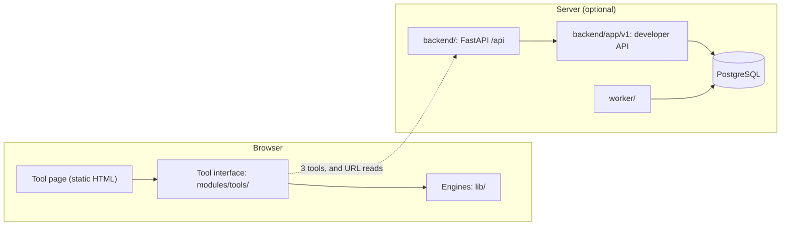

# Architecture

GigAI Tools is one repository with four parts: a static website, an optional FastAPI backend, the developer API inside that backend, and a task worker for the developer API.

## The registry

Every tool is one file in `config/tools/<category>/<slug>.ts` that exports a `Tool` object (the type is in `types/index.ts`). It holds the tool's name, slug, category, the copy for its page (description, features, how-to steps, formats, FAQ, troubleshooting) and its related tools. `config/tools/index.ts` collects them into `TOOLS`. Nothing about a tool's page is hard-coded anywhere else.

The same pattern holds the other content: `config/categories.ts`, `config/workspaces.ts`, `config/problems.ts` (the `/solve` pages), `config/glossary.ts`, `config/contexts.ts` (the `/for` pages), `config/comparisons/` and `config/howtos/`. Blog posts are Markdown files in `content/blog/`.

`lib/registry.ts` is the read layer: `getAllTools`, `getToolBySlug`, `getToolsByCategory` and the related-tool lookups.

## The pages

`app/[tool]/page.tsx` turns every registry entry into a static page with `generateStaticParams`. For each tool it builds:

- the metadata (`lib/seo.ts`): title, description, canonical URL, Open Graph;
- the structured data (`lib/schema.tsx`): `SoftwareApplication`, `HowTo`, `FAQPage`, `BreadcrumbList`;
- the page sections from the tool's copy;
- a per-tool Open Graph image (`app/[tool]/opengraph-image.tsx`), rendered at build time.

`app/sitemap.ts`, `app/robots.ts`, `app/llms.txt/route.ts` and `app/feed.xml` are generated from the same registry. The whole site is exported to static files (`output: "export"` in `next.config.ts`).

## The tool interfaces

`components/tool/tool-ui-registry.ts` maps each slug to its interface in `modules/tools/<category>/<slug>-tool.tsx`, loaded with `next/dynamic` and `ssr: false`, so each tool's code is its own chunk and loads only on its page. Shared pieces (the upload area, the workspace shell, export buttons, the success panel) are in `components/tool/`.

Pass client components only the fields they render. `lib/utils.ts` has `toToolCardData` and `toWorkspaceToolData` for this: passing whole `Tool` objects serialises every tool's copy into every page and multiplies the build size.

## The engines

`lib/` holds the code that does the work, one folder per domain, with no React in it: `pdf/`, `image/`, `dev/`, `qr/`, `svg-tools/`, `seo-tools/`, `geo/`, `document-tools/`, `video-tools/` (ffmpeg.wasm), `audio-tools/`, `video-intel/` (Whisper through Transformers.js), `file-intel/`, `iconlab/` and more. Engines take files or text and return results, so they are tested directly in `lib/<domain>/__tests__/` with Vitest.

Large engines load only when a tool needs them: the ffmpeg core from `public/ffmpeg/` (copied from `node_modules` at install), pdf.js workers from the build, and speech and embedding models from Hugging Face on first use.

## The backend

`backend/` is a FastAPI app (`app/main.py`). `app/api/router.py` mounts the `/api` routes; `app/services/` holds their logic; `app/core/config.py` holds the settings. It serves Video to Work, GigAI Verify, IconLab's AI composer, the newsletter, the optional LibreOffice converter and, when enabled, [PDF repair](guides/pdf-repair.md). See [The backend](guides/backend.md).

## The developer API and the worker

`backend/app/v1/` is the `/v1` API: accounts, API keys, jobs, files, webhooks, usage, site audits, poster pages and admin. It is mounted only when `GIGAI_API_JWT_SECRET` is set. Its engine catalogue is `backend/app/v1/engines.json`, which the website also reads at build time for the API docs pages.

`worker/` claims queued tasks from PostgreSQL and runs them. See [The developer API](guides/developer-api.md) and [The task worker](guides/worker.md).

## Repository layout

| Path | What it is |
|---|---|
| `app/` | Next.js routes: tool pages, categories, blog, guides, developer docs |
| `components/` | React components, by area |
| `modules/tools/` | One interface per tool |
| `lib/` | Engines and site libraries |
| `config/` | The registries: tools, categories, workspaces, guides |
| `content/blog/` | Blog posts (Markdown) |
| `public/` | Static files: pdf.js data, brand, images, the service worker |
| `backend/` | FastAPI backend, developer API (`app/v1/`) and PDF repair (`app/pdf_repair/`, AGPL) |
| `worker/` | Developer API task worker |
| `cloudflare/social-fetch/` | The URL fetch proxy, as a Cloudflare Worker and a Node service |
| `ops/` | Example nginx, systemd and cron files for one server |
| `scripts/` | Build helpers (ffmpeg copy, icon subset, tool docs) and QA scripts |
| `docs/` | This documentation |
